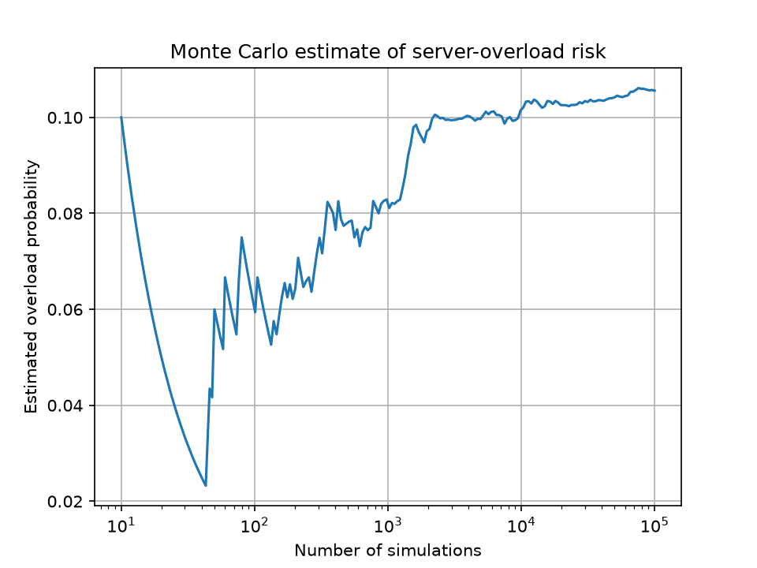
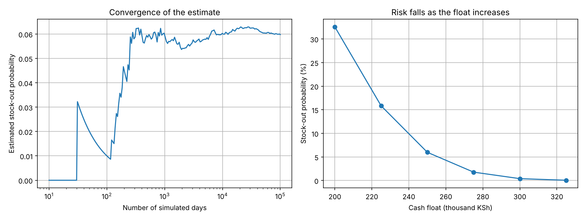

# BIT 2118 Scientific Computing: Task S (Random Numbers and Monte Carlo Methods)

## 1. Original program: `code/Task_20_monte_carlo.py`

**Problem:** estimate the probability that a server is overloaded when incoming demand is uncertain.

**Inputs**
- `capacity = 1000` (maximum demand the server can handle)
- `mean_demand = 850`, `std_demand = 120` (demand is normally distributed)
- `N = 100,000` simulated scenarios
- seed `42` (makes results repeatable)

**Mathematical operations**
1. `rng.normal(mean, std, N)` generates N random demand values.
2. `demand > capacity` marks each scenario overloaded (True) or not (False).
3. `.mean()` of those True/False values is the estimated probability.
4. `cumsum / arange` gives the running estimate after 1, 2, 3, ... simulations, which is what the graph shows.

**Result (original settings):** 10.6160% of scenarios overloaded (10,616 out of 100,000).



**Graph interpretation:** below about 30 simulations the estimate is 0 because no overload has appeared yet. Between 30 and 300 simulations it jumps sharply, because each new overload changes a small sample a lot. From about 1,000 simulations it stays near 0.10 to 0.11, and at 100,000 it settles near 0.106. This is the law of large numbers: more random samples give a more stable estimate.

## 2. Parameter changes (one change at a time)

| Run | Change | Probability | Cases |
|---|---|---|---|
| 0 | Original | 10.6160% | 10616 |
| 1 | capacity = 1100 | 1.9120% | 1912 |
| 2 | mean_demand = 900 | 20.2210% | 20221 |
| 3 | std_demand = 150 | 15.8390% | 15839 |
| 4 | N = 100 | 2.0000% | 2 out of 100 |
| 5 | seed = 7 | 10.5580% | 10558 |

**Explanations**
- **Capacity up (1000 to 1100):** more headroom above typical demand, so overloads become rarer (10.6% down to 1.9%).
- **Mean up (850 to 900):** typical demand sits closer to capacity, so overloads become more common (10.6% up to 20.2%).
- **Std up (120 to 150):** demand varies more, so more extreme high-demand days occur and the probability rises (10.6% up to 15.8%).
- **N down (100,000 to 100):** the estimate becomes unreliable. The true value is about 10.6%, but 100 samples gave 2%.
- **Seed change (42 to 7):** the answer moved only slightly (10.6160% to 10.5580%). Monte Carlo results vary a little with the random sequence, and the variation is small when N is large.

## 3. Modified program: `code/Task_20_modified.py` (M-Pesa agent cash float)

**Real-world case:** an M-Pesa agent holds a cash float each morning. If customer withdrawals during the day exceed the float, the agent runs out of cash (a stock-out) and customers are turned away. How likely is that, and how much float is enough?

**New assumptions**
- Daily withdrawals follow a normal distribution.
- Mean daily withdrawals = KSh 180,000 and standard deviation = KSh 45,000. These are assumed illustrative values, not measured data. They should be replaced with the agent's own records.
- Withdrawals cannot be negative, so negative samples are set to 0.
- Each day is independent of the others.
- No mid-day top-up of the float.

**Input data**
- Cash float = KSh 250,000
- N = 100,000 simulated days, seed 42
- Float levels tested: 200,000 to 325,000 in steps of 25,000

**Output**

```
Estimated stock-out probability: 5.9810%
Stock-out days: 5981 out of 100000
Expected stock-out days per 30-day month: 1.79

Float level (KSh) vs stock-out probability:
    200,000  ->  32.5670%
    225,000  ->  15.8390%
    250,000  ->  5.9810%
    275,000  ->  1.7790%
    300,000  ->  0.4000%
    325,000  ->  0.0610%
```



**Interpretation:** with a float of KSh 250,000, the agent would run out of cash on about 6% of days, roughly 1 to 2 days in a month. Raising the float to KSh 300,000 cuts this to 0.4%, about one day in 250. The left graph shows the estimate stabilising as more days are simulated. The right graph shows that risk falls steeply as the float increases, with diminishing returns beyond KSh 300,000. An agent can use this to balance the cost of tying up cash against the cost of lost customers. This is a model built on assumed numbers, so the results are only as good as those assumptions.

## 4. How to run

```
pip install numpy matplotlib
python code/Task_20_monte_carlo.py
python code/Task_20_modified.py
```
